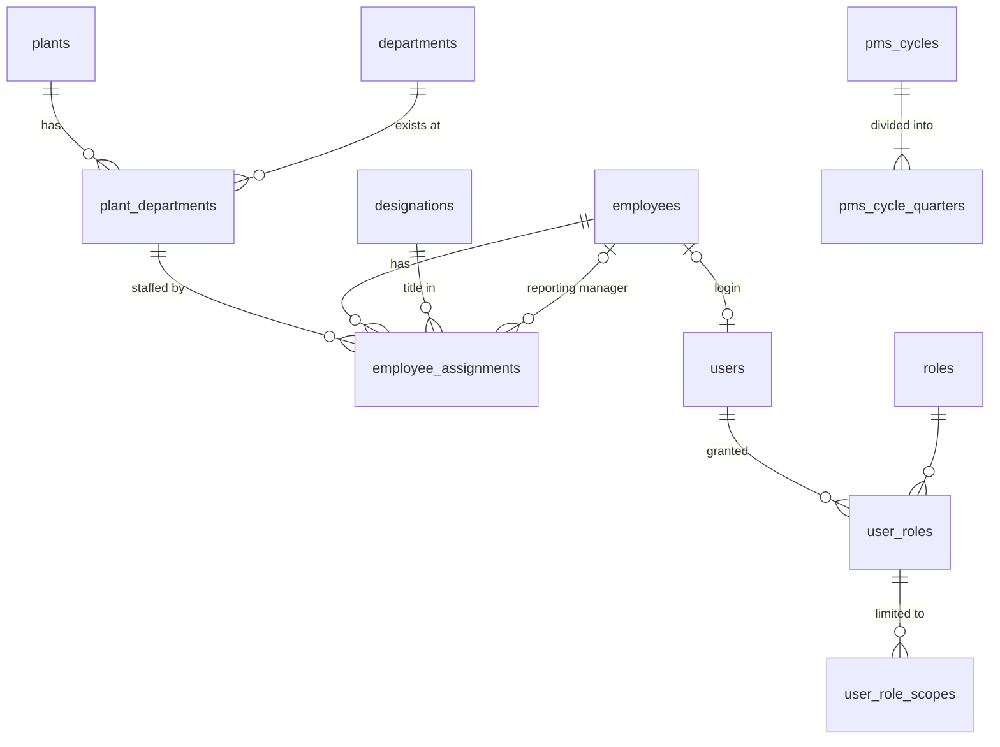

# PMS Database Design — Foundational Schema

Status: **applied**. Migration `86106da9cf57` was applied to `pms` on
2026-10-12 and verified: 12 tables, 14 foreign keys, 7 CHECK constraints,
20 unique constraints, no drift.
Models live in `PMS_Backend/app/models/`.

## Conventions

- Every table has an internal integer `id` primary key. Business identifiers
  (`plants.code`, `departments.code`, `employees.employee_code`, ...) are
  separate, unique columns, so they can change without breaking relationships.
- No cascading deletes. Organizational records are deactivated
  (`is_active = 0`), never deleted, so historical scores and budgets keep
  their references.
- Constraint names follow the naming convention in `app/db.py`
  (`pk_`, `fk_`, `uq_`, `ix_`, `ck_`), so later migrations can alter them.
- `created_at` / `updated_at` are maintained by MySQL.
- Date ranges use an inclusive `effective_to`; `NULL` means "still current".

## Entity relationships

| Table | Purpose | Key rules |
|---|---|---|
| `plants` | Plant master | `code`, `name` unique |
| `departments` | **Shared** department master ("Quality") | `code`, `name` unique; one row regardless of plant count |
| `plant_departments` | A department at a plant ("Quality — Plant A"). The unit for assignments, budgets and reports | unique (`plant_id`, `department_id`) |
| `designations` | Job titles; future anchor for standardized JDs | `code`, `name` unique |
| `employees` | **One row per person** | `employee_code` unique; exit ≥ joining |
| `employee_assignments` | Dated link employee → plant-department, with designation, reporting manager and `is_primary` | see below |
| `users` | Login account, separate from the employee profile | optional unique `employee_id` (one login per person) |
| `roles` | ADMIN, HR, CHRO, DEPT_HEAD, EMPLOYEE, BUDGET_USER (seeded later) | `code` unique |
| `user_roles` | Grants a role to a user | unique (`user_id`, `role_id`) |
| `user_role_scopes` | The organizational reach of a role grant | shape check + composite FK |
| `pms_cycles` | Annual cycle with configurable dates and status | `code` unique; end > start |
| `pms_cycle_quarters` | Four quarters per cycle, own dates, optional feedback flags | unique (`cycle_id`, `quarter_number`); 1–4 |

### Employee assignments (multi-plant employees)

Employee E001 working in Quality at Plant A and supporting Quality at Plant B
has one `employees` row and two `employee_assignments` rows. A transfer or
promotion closes the current row (sets `effective_to`) and inserts a new one,
so history is preserved.

The database enforces:
- `effective_to >= effective_from`, and a manager cannot be the employee.
- At most one **open** assignment per employee per plant-department.
- At most one **open primary** assignment per employee.
- No duplicate (employee, plant-department, start date).

MySQL has no partial unique indexes, so the two "open" rules use stored
generated columns (`open_assignment_flag`, `open_primary_employee_id`). These
are NULL for closed rows, and NULLs never collide in a unique index.

Overlap between closed historical ranges, and "every active employee has
exactly one primary assignment", are multi-row rules. They belong in the
service layer.

### Access scopes

Access is never inferred from a department name. Each role grant has explicit
scope rows:

| `scope_type` | `plant_id` | `department_id` | Meaning |
|---|---|---|---|
| `GLOBAL` | NULL | NULL | Everything (Admin, CHRO) |
| `PLANT` | set | NULL | All departments at one plant |
| `DEPARTMENT` | NULL | set | One department at every plant, including future plants |
| `PLANT_DEPARTMENT` | set | set | One department at one plant |

A CHECK constraint enforces this shape. A composite foreign key ensures that a
`PLANT_DEPARTMENT` scope names a department that actually exists at that
plant. A role grant with no scope rows grants no data access (deny by default).

These scopes are enforced on every API endpoint. The role capabilities and
the rules for combining multiple roles are in [api.md](api.md#authorization-model).

### Reporting scopes

Both report types are filters over the same `plant_departments` rows. There
are no duplicate department records:

- **Quality — Plant A**: `department_id = Quality AND plant_id = A`
- **Quality — All Plants**: `department_id = Quality` (every plant where it exists)

Every later fact table (KRA applicability, monthly performance, scores,
budgets, allocations) will reference `employee_assignments` or
`plant_departments`. Reports can therefore always be grouped per plant or
across plants. The API intersects the requested filter with the caller's
`user_role_scopes`.

### PMS cycle and quarters

Cycle and quarter boundaries are data, not calendar logic. The demo will seed
an April–March cycle as configuration only. Quarterly feedback is controlled
per quarter: `feedback_enabled` (default on) and `feedback_blocking`
(default off, so feedback is non-blocking).

## Multi-plant employees: approved business rules

Approved 2026-10-12. The foundational schema needs only `is_primary` for
these rules. The scoring, normalization and budget modules must implement
them as written.

### 1. Headcount
- Count each unique employee **exactly once**, attributed to their **primary**
  assignment. Two assignment rows must never produce two heads.
- Already implemented by `GET /api/reports/headcount`. Per-unit headcounts
  sum to the scope total. Secondary ("supporting") staff are reported
  separately, never added to headcount. Employees with a current assignment
  but no current primary are counted as a data issue, not silently dropped.

### 2. Quarterly 20–60–20 normalization
- Each employee is **one participant**, counted once in the applicable
  population.
- Population depends on the configured policy scope:
  - plant + department scope: attribute by primary assignment;
  - department-wide scope (all plants): use the consolidated departmental
    population.
- The policy (bands, scope, eligible population, minimum pool size,
  exceptions) is **configuration**, per cycle and overridable by
  department/plant/grade. It is never hard-coded.

### 3. Performance scoring across assignments
- KRA applicability and performance data are recorded **per assignment**,
  under one employee identity.
- The consolidated employee score is **not** a simple unweighted average of
  assignment scores. It uses an explicit, configurable aggregation policy.
  The preferred policy is **cycle-specific assignment contribution weights
  that total 100%**. An alternative must be another formally defined
  KRA-based weighting rule.
- **Missing or invalid weights** (absent, or not totalling 100%) flag the
  employee's score as blocked. A potentially misleading score is never
  published.
- Calculate one consolidated **quarterly** employee score before
  normalization, whenever the policy evaluates the employee as a single
  participant. Keep assignment-level scores for traceability.
- The **annual** score is derived from the *published* quarterly results,
  using the configured annual aggregation policy.

### 4. Budget and increment allocation
- For the demo, headcount and the employee-level increment are attributed to
  the **primary** assignment. They are never duplicated across plants.
- The design must allow a future, explicitly approved **cost-apportionment
  policy**, splitting one employee-related cost across units without
  duplicating the employee or the total increment. For example: a
  per-assignment apportionment table whose percentages total 100% and which
  references a single employee-level allocation record.
- Budget reconciliation must verify that each employee allocation is counted
  exactly once.

## Audit trail (`audit_events`, migration `bb82b01eddb7`)

This is the foundation for write-enabled modules (JD, KRA, scoring, budget,
approvals). Each consequential action adds one append-only row.

| Column | Meaning |
|---|---|
| `occurred_at`, `id` | When the action happened (server clock); `id` gives a strict order |
| `actor_type`, `actor_user_id`, `actor_username` | Who acted. `USER` rows must reference a user (CHECK constraint); `SYSTEM` is for automated jobs. The username is a snapshot. |
| `action` | Dotted code, e.g. `kra.update`, `jd.approve` |
| `entity_type`, `entity_id` | What was affected (indexed together for record history) |
| `plant_id`, `department_id` | Organizational context, so HR or Admin can later review events within their scope |
| `summary` | Safe, human-readable description (≤ 500 characters) |
| `reason` | Approved reason or justification, required when the action demands one |
| `changes` | JSON `{field: {"from", "to"}}` for the fields that changed |
| `request_id` | Optional correlation of several events from one request |

Rules (`app/services/audit.py`):

- **Same transaction.** `record_event()` adds the row to the caller's session
  and flushes, but never commits. The endpoint commits once, so a business
  change and its audit row are saved or rolled back together. Tests prove
  both cases.
- **Attribution.** The actor comes from the authenticated user
  (`AuditActorDep`), never from request input.
- **Safe content.** Values under keys that look like credentials or personal
  identifiers (password, token, secret, hash, API key, OTP, Aadhaar, PAN,
  bank account) are replaced with `[redacted]`. `changes` is limited to 16 KB,
  and unsupported value types are refused. Callers should list only the
  fields that matter.
- **Append-only.** No update or delete code exists. The database itself
  doesn't yet block UPDATE/DELETE on this table. For production, grant the
  application account only `INSERT, SELECT` on `audit_events`, or add a
  trigger, which needs additional MySQL privileges.

## JD and KPI management (Stage J)

Evidence: [JD_KPI_Scoring.md](JD_KPI_Scoring.md).

Decisions confirmed by the business (2026-10-14):

- A quarter **locks when an authorised user starts quarterly scoring**.
- Deviations are approved by an **HR Head** (new `HR_HEAD` role, or the CHRO)
  and a **Plant Head** (new `PLANT_HEAD` role). Both roles are plant-scoped,
  and two different people approve, neither of them the requester.
- The JD stores **all fields of the current JD format**, including the
  requisition fields.
- JD versions follow the format's **three-step sign-off**.

### Tables

| Table | Purpose | Key rules |
|---|---|---|
| `job_descriptions` | A **role** (not a designation): title, department, optional plant (NULL = every plant where the department exists), optional designation | `code` unique. One role title per department and plant: unique (`department_id`, plant key, `title`). The plant key is a generated column that makes NULL comparable. |
| `job_description_versions` | Every revision of a role's JD: document control, all current-format fields, responsibility sections and technical/behavioural competencies (JSON), and the sign-off trail | unique (`job_description_id`, `version_no`). At most one **APPROVED** version per JD, and at most one open draft (DRAFT, PROPOSED or AUTHORISED), both enforced by generated-column unique keys. Content can be edited only in DRAFT. |
| `kpi_scoring_policies` | Reusable **achievement matrix**: direction (higher-is-better, lower-is-better, zero tolerance), ordered bands `{threshold %, score}` with strict comparison as in the workbook, a fallback score, and met/breached scores for zero tolerance | `code` and `name` unique. Scores 0–5; whether 0 is allowed is still open (finding D5). |
| `kpi_definitions` | Shared **KPI library** entry: one row per *meaning* (name, description, unit, direction, default scoring policy, data source) | `code` and `name` unique. Reused across employees and quarters, never copied per employee. |
| `kpi_applicabilities` | Where a KPI may be used: department at a plant, a department at all plants, or company-wide | Plant and department are matched as a pair, with a composite FK to `plant_departments`; duplicates are blocked by generated-column keys. |
| `kpi_sheets` | An employee **assignment's KPI set for one quarter** (the assignment is the plant-department unit, per the approved multi-plant rules). Optional link to the role's JD. | unique (`employee_assignment_id`, `cycle_quarter_id`). Status DRAFT → PUBLISHED → LOCKED. |
| `kpi_sheet_items` | One KPI on a sheet: weightage, quarterly target and target note, unit, scoring policy. At publication, a **frozen copy of the policy** is stored so later policy edits never change history. | unique (`sheet_id`, `kpi_definition_id`). 0 < weightage ≤ 100, two decimal places. |
| `kpi_deviations` | Request to change a **locked** sheet: reason, original items, proposed items, HR Head and Plant Head approvals with timestamps, rejection | One PENDING request per sheet. The two approvers must differ (CHECK constraint), and neither may be the requester (service rule). |

### Workflow and validation

- **JD sign-off.** DRAFT → *propose* (Dept Head / HR / HR Head) → PROPOSED →
  *authorise* (Plant Head) → AUTHORISED → *approve* (CHRO) → APPROVED.
  - The previously approved version becomes SUPERSEDED.
  - Either reviewer can *return* the version to DRAFT with a reason.
  - Consecutive steps must be signed by different people.
  - A new revision copies the approved version into a new DRAFT.
  - "Available budget" can be set only by HR roles, as the form says.
- **KPI sheets.**
  - DRAFT sheets are edited freely, including via Excel upload.
  - **Publish** requires weightages to total exactly **100.00 %**. Totals are
    computed with decimals; 33.33 × 3 = 99.99 is refused.
  - Every KPI must be applicable to the assignment's plant and department,
    and the assignment must be current during the quarter.
  - Having fewer than 3 or more than 5 KPIs produces a warning, not an error
    (the requirements call the count guidance).
  - A published sheet can be reopened while its quarter has not started.
  - **Start quarterly scoring** (HR Head, CHRO or Admin, with company-wide
    scope) moves the quarter to OPEN and locks every published sheet. After
    that, no ordinary edit, publish or reopen is accepted for that quarter.
  - A sheet can be copied into a later quarter as a new draft.
- **Deviations.** Only for sheets in a started quarter.
  - The request records a reason and the full proposed item list, which must
    total 100 %.
  - When both approvals are present, the change is applied **in the same
    transaction** as the final approval.
  - It is audited with the original and revised values, both approvers and
    their timestamps.
- **Excel upload** (`.xlsx`, Department Head template).
  1. *Preview* parses and validates without writing.
  2. *Confirm* re-validates and writes all affected sheets as DRAFT in one
     transaction. It refuses if any error remains.

  Checks: employee in scope; assignment resolvable (plant and department
  required when ambiguous); KPI exists in the library and applies to that
  unit; no duplicate KPI per employee; numeric weightage and target; totals
  = 100 %; the quarter has not started. Uploaded sheets still need publishing:
  that is the review step.
- **Audit.** Every consequential action writes an `audit_events` row in the
  same transaction: JD create, edit and each sign-off step; KPI and policy
  changes; sheet edits, publish, reopen, upload and copy; quarter start; and
  deviation request, approval, rejection and application.

### Permissions (added to the role map)

| Capability | Roles | Scope |
|---|---|---|
| Read JDs, KPIs, policies, sheets | all `org:read` roles; employees see their own sheets | scoped |
| Create and edit JD drafts, propose | DEPT_HEAD, HR, HR_HEAD, ADMIN | scoped |
| Authorise JD | PLANT_HEAD | scoped |
| Approve JD | CHRO | scoped |
| KPI library, sheets, upload, publish, reopen, request deviation | DEPT_HEAD, HR, HR_HEAD, ADMIN | scoped; company-wide KPIs and policies need GLOBAL |
| Start quarterly scoring | HR_HEAD, CHRO, ADMIN | **GLOBAL** only |
| Approve deviation as HR Head | HR_HEAD, CHRO | scoped to the sheet's unit |
| Approve deviation as Plant Head | PLANT_HEAD | scoped to the sheet's unit |

### Not in Stage J

Monthly and quarterly actuals, score computation for real data, the
scoring-period workflow, normalisation, increments, CR and budgets. A
`preview` endpoint evaluates a scoring policy for a given achievement %; it
exists to check policies against the workbook examples.

## Configurable matrices and monthly scoring (Stage K)

Decisions confirmed by the business (2026-10-15):

- Scoring logic is configured per KPI or scoring policy. There is no
  universal direction, and a direction is never inferred from a KPI title.
- KPI scoring, KRA performance, compa-ratio (CR) impact and increment
  matrices are **configuration, not code**. HR Head users author them; the
  **CHRO approves** a version before it can become active; every change is a
  new version.
- Published KPI sheets keep the exact matrix version that governed them, and
  published scores never change silently.
- The manager's final score is calculated from KPI scores and weightages. A
  manual override is a separate deviation: reason, HR Head (or CHRO) and
  Plant Head approval (two different people, neither the requester), audit.
- A zero-tolerance KPI may score 5 for no incidents and 0 otherwise when that
  is its approved rule; a matrix may return 0 although ratings are 1–5.
- Age band and gender stay outside active data collection until HR/legal
  confirm a lawful need, and never influence scoring.
- Company-wide quarter locking stays; it needs a global role.

### Concepts

- A **matrix type** (KPI scoring, KRA performance, CR impact, increment) is
  declared in code (`app/services/matrix_types.py`): its standard input
  fields, fixed output fields, allowed data types and sources, and limits.
  Types are validated against this registry, so adding a type needs no
  schema change. Adding one still needs a code review (see
  [matrix-framework.md](matrix-framework.md)).
- A **matrix** is one named configuration lineage, e.g. "Higher is better
  (standard)". Its **versions** hold the content as a declarative **decision
  table**:
  - the input and output **fields** it uses (key, label, data type, unit,
    range, allowed values, how the value is obtained);
  - **rules**: a unique priority, conditions per input field, and output
    values;
  - what happens **when no rule matches** (an explicit default output, or
    stop with an error);
  - **test cases** (inputs and expected outputs) that must pass before
    submission.

  Each version stores its own field definitions, so it stays interpretable
  even after the type gains fields.
- **Rules never overlap.** For any input, at most one rule may match.
  Overlapping rules, empty or unreachable ranges, duplicate priorities,
  malformed conditions, non-finite numbers and unsupported types or
  operators are validation errors. Gaps are reported. Range bounds state
  explicitly whether they include the boundary ("more than 100" vs "at least
  100"), which keeps the workbook's strict comparisons (exactly 100 % scores
  4, not 5).
- No expression language: input values come from an **allow-listed set of
  derivations** (KPI actual, target, actual ÷ target × 100, actual − target,
  an imported column). Nothing in a matrix, upload or spreadsheet is ever
  executed as code; uploaded cells containing formulas are refused.

### Tables (migration in this stage, additive only)

| Table / change | Purpose | Key rules |
|---|---|---|
| `matrices` | One configuration lineage: code, **type** (registry code), name, description, type-specific attributes (e.g. the KPI direction) | `code` unique; unique (`matrix_type`, `name`) |
| `matrix_versions` | Versioned content: decision-table definition (JSON) and its SHA-256, schema version, effective dates, change summary, source (portal, upload with file name and hash, or seed), template version, and the trail: created, submitted, approved/rejected (with note or reason), published, superseded | unique (`matrix_id`, `version_no`). At most **one open** (DRAFT or SUBMITTED) version per matrix (generated-column unique key). CHECK: the approver is not the submitter. Content changes only in DRAFT. |
| `matrix_version_scopes` | Where a version applies: company-wide, a department at all plants, a plant, or one unit | Same pairing rules and composite FK as `kpi_applicabilities` |
| `kpi_scoring_policies.matrix_id` | Each scoring policy (the handle KPIs and sheet items already reference) is backed by one KPI-scoring matrix | Nullable, unique. A policy without a matrix (Stage J "legacy" bands) cannot be used for new publications. |
| `kpi_definitions` + `aggregation`, `reporting_frequency`, `measurement_method` | How a KPI is measured: monthly or quarterly reporting, and how monthly actuals combine into the quarter (sum, average, last, min, max) | Nullable. Publishing a sheet requires them to be set. |
| `kpi_definitions.direction`, `kpi_scoring_policies.direction` | ENUM gains `TARGET_RANGE`, `CATEGORICAL`, `COMPOSITE` | Existing values unchanged |
| `kpi_sheet_items` + `matrix_version_id`, `measurement_snapshot` | The **exact** matrix version and measurement semantics frozen at publication (or when a deviation is applied) | Set only for Stage K publications; Stage J items keep their `scoring_snapshot` |
| `kpi_data_imports` | One confirmed monthly import: quarter, month, file name, SHA-256, size, format, column mapping, row counts, importer | The file itself is never stored |
| `kpi_monthly_values` | Imported source value per sheet, KPI and month: actual, extra input values (JSON), source import and row | unique (`sheet_id`, `kpi_definition_id`, `period_month`) |
| `kpi_sheet_results` | Calculated result per sheet: status CALCULATED → REVIEWED → PUBLISHED, completeness, exact weighted score, final score (2 dp), published score, per-KPI explanation, hash of the inputs used | One per sheet. Immutable once PUBLISHED. |
| `kpi_score_overrides` | A manual final-score override as a deviation: original and proposed score, reason, HR-side and plant-side approvals, rejection, application, voiding | One PENDING per result; CHECKs: distinct approvers, approver ≠ requester |

Migration effects: new tables, new nullable columns and enum values only.
No row is changed, no column or table is dropped, and Stage J data
(policies, frozen snapshots, sheets, deviations) remains valid. `downgrade()`
drops the new tables and columns; it is never run without approval.

### Workflow

- **Matrix versions.**
  1. HR Head (in scope; company-wide needs GLOBAL) saves a DRAFT, validates it
     and previews representative inputs.
  2. *Submit* requires zero validation errors, passing test cases, an
     effective date and applicability.
  3. The CHRO *approves* (re-validated) or *rejects* with a reason. The
     approver must differ from the submitter and the author.
  4. An approved version is *published* by the HR Head or the CHRO.
     - Earlier published versions of the same matrix end the day before it
       takes effect, or become SUPERSEDED if they had not started yet.
     - For types chosen by applicability (KRA, CR, increment), another
       matrix of the same type may not overlap in dates and scope.
  5. A *revision* copies the latest version into a new DRAFT. Rejected
     versions stay in the history.
  6. A submitted version can be withdrawn to DRAFT by its author.
- **KPI sheets.**
  - Publishing (or applying a deviation) resolves, for every item, the
    PUBLISHED version of the item's scoring policy. It must be effective on
    the quarter's start date and its applicability must cover the
    assignment's unit.
  - That version id and the KPI's measurement semantics are frozen on the
    item.
  - A missing or ambiguous version, an undefined measurement, or a matrix
    needing a target that is missing blocks publication. Nothing falls back
    to a default.
- **Monthly data.**
  1. Choose quarter and month, upload CSV or XLSX, and map columns to the
     documented contract. Only published or locked sheets accept data, and
     only for months that have started.
  2. *Preview* writes nothing.
  3. *Confirm* re-validates and saves everything or nothing.
  4. Re-imported identical values are unchanged. Different values are
     replaced only with explicit confirmation. A file with the same hash is
     flagged.
- **Results.**
  - *Calculate* (KPI writers in scope) aggregates monthly values per the
    frozen measurement, derives the matrix inputs, evaluates the frozen
    version and adds weighted contributions (score × weightage ÷ 100, exact
    decimals). The final score is rounded half-up to 2 decimals.
  - Results with missing months are marked incomplete.
  - *Review* is done by the manager (KPI writers). *Publish* (HR Head or
    CHRO, in scope) needs a complete, current, locked sheet, then freezes
    the result.
  - New data, a deviation or a matrix change makes an unpublished result
    stale until recalculated. Data, deviations and recalculation are refused
    once results are published.
- **Overrides** follow the deviation rules. Recalculation voids a pending or
  applied override, which must then be requested again.

### Permissions (added to the role map)

| Capability | Roles | Scope |
|---|---|---|
| `matrix:read` (KPI scoring, KRA) | ADMIN, CHRO, HR_HEAD, HR, PLANT_HEAD, DEPT_HEAD, BUDGET_USER | scoped by applicability |
| `matrix:read_compensation` (CR, increment) | ADMIN, CHRO, HR_HEAD | scoped |
| `matrix:write` (author, submit, withdraw, publish, upload) | HR_HEAD | scoped; company-wide needs GLOBAL |
| `matrix:approve` (approve, reject, publish) | CHRO | scoped |
| Monthly import, calculate, review | `kpi:write` roles | scoped to the sheet's unit |
| `score:publish` | HR_HEAD, CHRO | scoped |
| Override approvals | `deviation:approve_hr`, `deviation:approve_plant` | scoped |

## Quarterly review, normalization and publication (Stage L)

Decisions confirmed by the business (2026-10-26):

- KPI scoring is configured per KPI through its approved matrix. A genuine
  zero-tolerance KPI may score 5 for no incidents and 0 for one or more when
  that rule is approved (closes D1). No global direction is imposed; each
  KPI's direction and matrix are explicit (closes D2).
- A KPI score of 0 and the 1–5 performance-rating scale are separate
  concepts. A rating comes only from an approved, configured mapping
  (closes D5).
- The manager's/employee's score is calculated from weighted KPI
  contributions; a manual override is a controlled deviation (closes the
  "manager's final score" question).
- Quarterly feedback is optional and never blocks publication. Quarterly
  locking is company-wide, by a global role.
- Cross-plant employees keep one identity: assignment scores stay separate,
  and an employee is counted once in a normalization cohort.

### Quarter lifecycle

`pms_cycle_quarters.status` gains four values; the existing ones keep their
meaning:

| Status | Meaning | Data and scores |
|---|---|---|
| `DRAFT` | KPI setup | sheets editable |
| `OPEN` | Scoring started (sheets locked): **data collection** | imports, calculation, deviations, overrides, department review |
| `DEPARTMENT_REVIEW` | Data collection closed; departments review | review, overrides, comments, contribution weights; data frozen |
| `NORMALIZATION` | Employee scores consolidated and normalized | cohort placement and approval only |
| `READY` | Every cohort approved | publication only |
| `PUBLISHED` | Published and locked | nothing changes |
| `CLOSED` | Historic quarter (demo seed) | read-only |

Forward steps need a GLOBAL `quarter:start` role (HR Head, CHRO, Admin) and
pass explicit gates; each forward step can be undone one step back with a
recorded reason. Publication needs GLOBAL `score:publish` (HR Head, CHRO).

| Step | Gate (company-wide) |
|---|---|
| OPEN → DEPARTMENT_REVIEW | every locked sheet has a current, complete calculation |
| DEPARTMENT_REVIEW → NORMALIZATION | every result reviewed, current, no pending override; every employee's score can be consolidated (contribution weights where needed); every eligible employee is covered by an approved normalization policy. Employee scores are then frozen into `employee_quarter_results` and the cohorts computed. |
| NORMALIZATION → READY | every cohort approved |
| READY → PUBLISHED | one transaction: every sheet result, employee result and cohort is published, the quarter records who published it and when |

**Missing data (recommended default, applied consistently).** Every KPI
needs a value for every month in which the assignment was active (one value
for a quarterly KPI). Missing data is never treated as zero: the result stays
incomplete and blocks the quarter at the first gate, with the missing months
listed. Corrections after data collection closes need the quarter moved back
to data collection (global role, reason recorded). After publication nothing
changes; deviations, imports and recalculation are refused.

### Employee consolidation

- An employee's quarterly score uses the assignments that have a locked KPI
  sheet in the quarter. Each assignment contributes its final score (or its
  approved override).
- One scored assignment: it contributes 100 %. Several: **explicit
  contribution weights** for exactly those assignments, each above 0 and
  together exactly 100.00 % (HR Head or CHRO covering all of them). Never an
  unweighted average; missing or invalid weights block the employee.
- Exact sum, then rounded half-up to 2 decimals.
- **Attribution:** the primary assignment active at the end of the quarter
  (else the latest primary that overlaps it). No primary is a blocker.

### Normalization policy

A new matrix type, `NORMALIZATION`, so policies get versioning, CHRO
approval, effective dates, applicability and history from Stage K. A version
holds `settings` (validated by the rule engine) and a decision table mapping
a group (and optionally the score) to a normalized rating:

- `cohort_level`: COMPANY, PLANT, DEPARTMENT (consolidated across plants) or
  PLANT_DEPARTMENT, applied to each employee's attribution unit.
- `groups`: ordered best first, each with a target percentage; exactly one
  takes the remainder; percentages total 100 (20/60/20 is the intended
  default, but nothing is fixed).
- `size_rounding` for the non-remainder groups: NEAREST (half-up), DOWN, UP.
- `rank_by`: FINAL_SCORE (2 decimals) or EXACT_SCORE.
- `ties` at a group boundary: REQUIRE_RESOLUTION, HIGHER_GROUP (all tied
  employees go to the better group) or LOWER_GROUP. Ties are never split
  silently.
- `min_cohort_size` and `small_cohort`: REQUIRE_RESOLUTION, or DEFAULT_GROUP
  with a named group.
- `eligible_designations`: designation codes (empty: everyone).

Only one normalization policy may apply to a unit and date (enforced at
publication, as for every applicability-selected type). The version in force
on the quarter's start date for the employee's attribution unit applies.

### Tables (migration in this stage, additive only)

| Table / change | Purpose | Key rules |
|---|---|---|
| `pms_cycle_quarters.status` | ENUM gains `DEPARTMENT_REVIEW`, `NORMALIZATION`, `READY`, `PUBLISHED` | existing values unchanged |
| `pms_cycle_quarters` + `published_at`, `published_by_user_id` | Who published the quarter and when | nullable |
| `assignment_score_weights` | Contribution weight of one assignment to its employee's quarterly score | unique (quarter, assignment); CHECK 0 < weight ≤ 100 |
| `employee_quarter_results` | Frozen employee score per quarter: components (assignment, sheet, score used, weight, contribution), exact and final score, attribution unit, inputs hash; normalization outcome: cohort, rank, group, how it was placed (automatic, tie resolution, small-cohort rule or resolution) with reason and person, normalized rating and the rule used; publication | unique (quarter, employee) |
| `normalization_runs` | One cohort per quarter: policy version, level and unit, population, target and actual group counts, exceptions, inputs hash, computation, approval (note) and publication | unique (quarter, cohort key); DRAFT → APPROVED → PUBLISHED, or DISCARDED |
| `kpi_sheet_comments` | Review comments and optional feedback on a sheet (append-only) | never required for any step |

Migration effects: new tables, nullable columns and enum values only. No row
is changed and nothing is dropped. `downgrade()` drops the new objects and
narrows the ENUM; it would fail if a quarter uses a new status, and is never
run without approval.

### Permissions

| Action | Who |
|---|---|
| Quarter steps forward and back | GLOBAL `quarter:start` (Admin, HR Head, CHRO) |
| Publish the quarter | GLOBAL `score:publish` (HR Head, CHRO) |
| Contribution weights | `score:publish` covering every scored assignment of the employee |
| Cohort placements (ties, small cohorts), approval | `score:publish` covering the cohort; nobody places themselves; the approver may not have placed any member and may not be a member of the cohort |
| Review | `kpi:write` in scope, never for one's own sheet (someone else with authority over the unit reviews it) |
| Comments, feedback | `kpi:write` in scope; reading follows the sheet |
| Employee (consolidated) results | org readers covering the employee's attribution unit or every component |
| Own sheets, published outcome and feedback | the employee (`self:read`) |

## Deferred, by design

- Grades and salary bands (needed for compa-ratio), JDs, KRAs, monthly data,
  scores and budgets come in later stages.
- Role-assignment history and audit logging. `user_roles` currently represents
  current access only.
- Timestamps use the MySQL server clock (local time). Revisit before any
  multi-timezone deployment.
