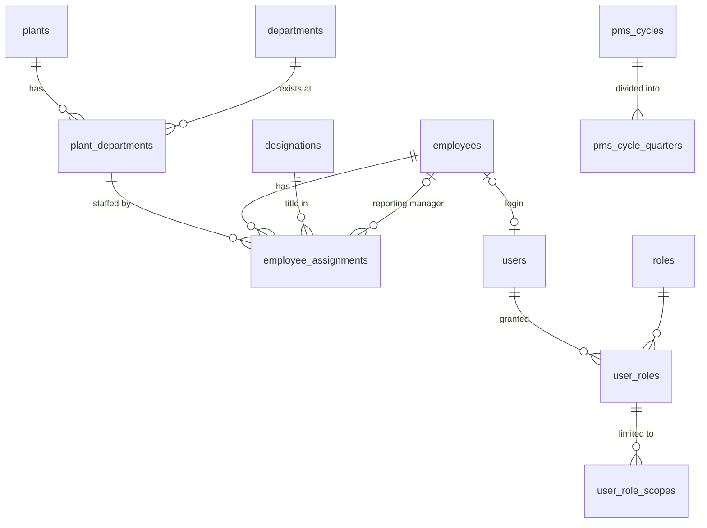

# PMS Database Design — Foundational Schema

Status: **applied**. Migration `86106da9cf57` was applied to `pms` on
2026-10-12 and verified: 12 tables, 14 foreign keys, 7 CHECK constraints,
20 unique constraints, no drift.
Models live in `PMS_Backend/app/models/`.

## Conventions

- Every table has an internal integer `id` primary key. Business identifiers
  (`plants.code`, `departments.code`, `employees.employee_code`, ...) are
  separate, unique columns, so they can change without breaking relationships.
- No cascading deletes. Organizational records are deactivated
  (`is_active = 0`), never deleted, so historical scores and budgets keep
  their references.
- Constraint names follow the naming convention in `app/db.py`
  (`pk_`, `fk_`, `uq_`, `ix_`, `ck_`), so later migrations can alter them.
- `created_at` / `updated_at` are maintained by MySQL.
- Date ranges use an inclusive `effective_to`; `NULL` means "still current".

## Entity relationships

| Table | Purpose | Key rules |
|---|---|---|
| `plants` | Plant master | `code`, `name` unique |
| `departments` | **Shared** department master ("Quality") | `code`, `name` unique; one row regardless of plant count |
| `plant_departments` | A department at a plant ("Quality — Plant A"). The unit for assignments, budgets and reports | unique (`plant_id`, `department_id`) |
| `designations` | Job titles; future anchor for standardized JDs | `code`, `name` unique |
| `employees` | **One row per person** | `employee_code` unique; exit ≥ joining |
| `employee_assignments` | Dated link employee → plant-department, with designation, reporting manager and `is_primary` | see below |
| `users` | Login account, separate from the employee profile | optional unique `employee_id` (one login per person) |
| `roles` | ADMIN, HR, CHRO, DEPT_HEAD, EMPLOYEE, BUDGET_USER (seeded later) | `code` unique |
| `user_roles` | Grants a role to a user | unique (`user_id`, `role_id`) |
| `user_role_scopes` | The organizational reach of a role grant | shape check + composite FK |
| `pms_cycles` | Annual cycle with configurable dates and status | `code` unique; end > start |
| `pms_cycle_quarters` | Four quarters per cycle, own dates, optional feedback flags | unique (`cycle_id`, `quarter_number`); 1–4 |

### Employee assignments (multi-plant employees)

Employee E001 working in Quality at Plant A and supporting Quality at Plant B
has one `employees` row and two `employee_assignments` rows. A transfer or
promotion closes the current row (sets `effective_to`) and inserts a new one,
so history is preserved.

The database enforces:
- `effective_to >= effective_from`, and a manager cannot be the employee.
- At most one **open** assignment per employee per plant-department.
- At most one **open primary** assignment per employee.
- No duplicate (employee, plant-department, start date).

MySQL has no partial unique indexes, so the two "open" rules use stored
generated columns (`open_assignment_flag`, `open_primary_employee_id`). These
are NULL for closed rows, and NULLs never collide in a unique index.

Overlap between closed historical ranges, and "every active employee has
exactly one primary assignment", are multi-row rules. They belong in the
service layer.

### Access scopes

Access is never inferred from a department name. Each role grant has explicit
scope rows:

| `scope_type` | `plant_id` | `department_id` | Meaning |
|---|---|---|---|
| `GLOBAL` | NULL | NULL | Everything (Admin, CHRO) |
| `PLANT` | set | NULL | All departments at one plant |
| `DEPARTMENT` | NULL | set | One department at every plant, including future plants |
| `PLANT_DEPARTMENT` | set | set | One department at one plant |

A CHECK constraint enforces this shape. A composite foreign key ensures that a
`PLANT_DEPARTMENT` scope names a department that actually exists at that
plant. A role grant with no scope rows grants no data access (deny by default).

These scopes are enforced on every API endpoint. The role capabilities and
the rules for combining multiple roles are in [api.md](api.md#authorization-model).

### Reporting scopes

Both report types are filters over the same `plant_departments` rows. There
are no duplicate department records:

- **Quality — Plant A**: `department_id = Quality AND plant_id = A`
- **Quality — All Plants**: `department_id = Quality` (every plant where it exists)

Every later fact table (KRA applicability, monthly performance, scores,
budgets, allocations) will reference `employee_assignments` or
`plant_departments`. Reports can therefore always be grouped per plant or
across plants. The API intersects the requested filter with the caller's
`user_role_scopes`.

### PMS cycle and quarters

Cycle and quarter boundaries are data, not calendar logic. The demo will seed
an April–March cycle as configuration only. Quarterly feedback is controlled
per quarter: `feedback_enabled` (default on) and `feedback_blocking`
(default off, so feedback is non-blocking).

## Multi-plant employees: approved business rules

Approved 2026-10-12. The foundational schema needs only `is_primary` for
these rules. The scoring, normalization and budget modules must implement
them as written.

### 1. Headcount
- Count each unique employee **exactly once**, attributed to their **primary**
  assignment. Two assignment rows must never produce two heads.
- Already implemented by `GET /api/reports/headcount`. Per-unit headcounts
  sum to the scope total. Secondary ("supporting") staff are reported
  separately, never added to headcount. Employees with a current assignment
  but no current primary are counted as a data issue, not silently dropped.

### 2. Quarterly 20–60–20 normalization
- Each employee is **one participant**, counted once in the applicable
  population.
- Population depends on the configured policy scope:
  - plant + department scope: attribute by primary assignment;
  - department-wide scope (all plants): use the consolidated departmental
    population.
- The policy (bands, scope, eligible population, minimum pool size,
  exceptions) is **configuration**, per cycle and overridable by
  department/plant/grade. It is never hard-coded.

### 3. Performance scoring across assignments
- KRA applicability and performance data are recorded **per assignment**,
  under one employee identity.
- The consolidated employee score is **not** a simple unweighted average of
  assignment scores. It uses an explicit, configurable aggregation policy.
  The preferred policy is **cycle-specific assignment contribution weights
  that total 100%**. An alternative must be another formally defined
  KRA-based weighting rule.
- **Missing or invalid weights** (absent, or not totalling 100%) flag the
  employee's score as blocked. A potentially misleading score is never
  published.
- Calculate one consolidated **quarterly** employee score before
  normalization, whenever the policy evaluates the employee as a single
  participant. Keep assignment-level scores for traceability.
- The **annual** score is derived from the *published* quarterly results,
  using the configured annual aggregation policy.

### 4. Budget and increment allocation
- For the demo, headcount and the employee-level increment are attributed to
  the **primary** assignment. They are never duplicated across plants.
- The design must allow a future, explicitly approved **cost-apportionment
  policy**, splitting one employee-related cost across units without
  duplicating the employee or the total increment. For example: a
  per-assignment apportionment table whose percentages total 100% and which
  references a single employee-level allocation record.
- Budget reconciliation must verify that each employee allocation is counted
  exactly once.

## Audit trail (`audit_events`, migration `bb82b01eddb7`)

This is the foundation for write-enabled modules (JD, KRA, scoring, budget,
approvals). Each consequential action adds one append-only row.

| Column | Meaning |
|---|---|
| `occurred_at`, `id` | When the action happened (server clock); `id` gives a strict order |
| `actor_type`, `actor_user_id`, `actor_username` | Who acted. `USER` rows must reference a user (CHECK constraint); `SYSTEM` is for automated jobs. The username is a snapshot. |
| `action` | Dotted code, e.g. `kra.update`, `jd.approve` |
| `entity_type`, `entity_id` | What was affected (indexed together for record history) |
| `plant_id`, `department_id` | Organizational context, so HR or Admin can later review events within their scope |
| `summary` | Safe, human-readable description (≤ 500 characters) |
| `reason` | Approved reason or justification, required when the action demands one |
| `changes` | JSON `{field: {"from", "to"}}` for the fields that changed |
| `request_id` | Optional correlation of several events from one request |

Rules (`app/services/audit.py`):

- **Same transaction.** `record_event()` adds the row to the caller's session
  and flushes, but never commits. The endpoint commits once, so a business
  change and its audit row are saved or rolled back together. Tests prove
  both cases.
- **Attribution.** The actor comes from the authenticated user
  (`AuditActorDep`), never from request input.
- **Safe content.** Values under keys that look like credentials or personal
  identifiers (password, token, secret, hash, API key, OTP, Aadhaar, PAN,
  bank account) are replaced with `[redacted]`. `changes` is limited to 16 KB,
  and unsupported value types are refused. Callers should list only the
  fields that matter.
- **Append-only.** No update or delete code exists. The database itself
  doesn't yet block UPDATE/DELETE on this table. For production, grant the
  application account only `INSERT, SELECT` on `audit_events`, or add a
  trigger, which needs additional MySQL privileges.

## Deferred, by design

- **Normalization policy** (configurable 20–60–20 bands, eligible population,
  minimum pool size, exceptions) will be added as a per-cycle configuration
  table when quarterly normalization is built. It will reference `pms_cycles`.
- Grades and salary bands (needed for compa-ratio), JDs, KRAs, monthly data,
  scores and budgets come in later stages.
- Role-assignment history and audit logging. `user_roles` currently represents
  current access only.
- Timestamps use the MySQL server clock (local time). Revisit before any
  multi-timezone deployment.
