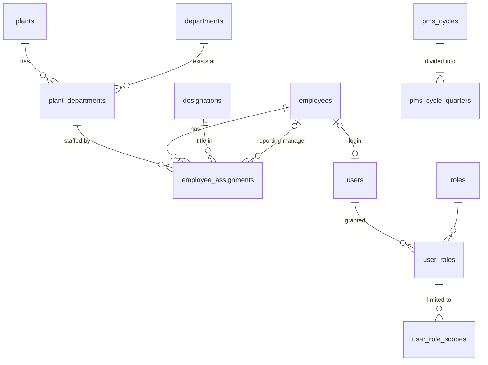

# PMS Database Design — Foundational Schema

Status: **applied**. Migration `86106da9cf57` was applied to `pms` on
2026-10-12 and verified: 12 tables, 14 foreign keys, 7 CHECK constraints,
20 unique constraints, no drift.
Models live in `PMS_Backend/app/models/`.

## Conventions

- Every table has an internal integer `id` primary key. Business identifiers
  (`plants.code`, `departments.code`, `employees.employee_code`, ...) are
  separate, unique columns, so they can change without breaking relationships.
- No cascading deletes. Organizational records are deactivated
  (`is_active = 0`), never deleted, so historical scores and budgets keep
  their references.
- Constraint names follow the naming convention in `app/db.py`
  (`pk_`, `fk_`, `uq_`, `ix_`, `ck_`), so later migrations can alter them.
- `created_at` / `updated_at` are maintained by MySQL.
- Date ranges use an inclusive `effective_to`; `NULL` means "still current".

## Entity relationships



| Table | Purpose | Key rules |
|---|---|---|
| `plants` | Plant master | `code`, `name` unique |
| `departments` | **Shared** department master ("Quality") | `code`, `name` unique; one row regardless of plant count |
| `plant_departments` | A department at a plant ("Quality — Plant A"). The unit for assignments, budgets and reports | unique (`plant_id`, `department_id`) |
| `designations` | Job titles; future anchor for standardized JDs | `code`, `name` unique |
| `employees` | **One row per person** | `employee_code` unique; exit ≥ joining |
| `employee_assignments` | Dated link employee → plant-department, with designation, reporting manager and `is_primary` | see below |
| `users` | Login account, separate from the employee profile | optional unique `employee_id` (one login per person) |
| `roles` | ADMIN, HR, CHRO, DEPT_HEAD, EMPLOYEE, BUDGET_USER (seeded later) | `code` unique |
| `user_roles` | Grants a role to a user | unique (`user_id`, `role_id`) |
| `user_role_scopes` | The organizational reach of a role grant | shape check + composite FK |
| `pms_cycles` | Annual cycle with configurable dates and status | `code` unique; end > start |
| `pms_cycle_quarters` | Four quarters per cycle, own dates, optional feedback flags | unique (`cycle_id`, `quarter_number`); 1–4 |

### Employee assignments (multi-plant employees)

Employee E001 working in Quality at Plant A and supporting Quality at Plant B
has one `employees` row and two `employee_assignments` rows. A transfer or
promotion closes the current row (sets `effective_to`) and inserts a new one,
so history is preserved.

The database enforces:
- `effective_to >= effective_from`, and a manager cannot be the employee.
- At most one **open** assignment per employee per plant-department.
- At most one **open primary** assignment per employee.
- No duplicate (employee, plant-department, start date).

MySQL has no partial unique indexes, so the two "open" rules use stored
generated columns (`open_assignment_flag`, `open_primary_employee_id`). These
are NULL for closed rows, and NULLs never collide in a unique index.

Overlap between closed historical ranges, and "every active employee has
exactly one primary assignment", are multi-row rules. They belong in the
service layer.

### Access scopes

Access is never inferred from a department name. Each role grant has explicit
scope rows:

| `scope_type` | `plant_id` | `department_id` | Meaning |
|---|---|---|---|
| `GLOBAL` | NULL | NULL | Everything (Admin, CHRO) |
| `PLANT` | set | NULL | All departments at one plant |
| `DEPARTMENT` | NULL | set | One department at every plant, including future plants |
| `PLANT_DEPARTMENT` | set | set | One department at one plant |

A CHECK constraint enforces this shape. A composite foreign key ensures that a
`PLANT_DEPARTMENT` scope names a department that actually exists at that
plant. A role grant with no scope rows grants no data access (deny by default).

These scopes are enforced on every API endpoint. The role capabilities and
the rules for combining multiple roles are in [api.md](api.md#authorization-model).

### Reporting scopes

Both report types are filters over the same `plant_departments` rows. There
are no duplicate department records:

- **Quality — Plant A**: `department_id = Quality AND plant_id = A`
- **Quality — All Plants**: `department_id = Quality` (every plant where it exists)

Every later fact table (KRA applicability, monthly performance, scores,
budgets, allocations) will reference `employee_assignments` or
`plant_departments`. Reports can therefore always be grouped per plant or
across plants. The API intersects the requested filter with the caller's
`user_role_scopes`.

### PMS cycle and quarters

Cycle and quarter boundaries are data, not calendar logic. The demo will seed
an April–March cycle as configuration only. Quarterly feedback is controlled
per quarter: `feedback_enabled` (default on) and `feedback_blocking`
(default off, so feedback is non-blocking).

## Multi-plant employees: approved business rules

Approved 2026-10-12. The foundational schema needs only `is_primary` for
these rules. The scoring, normalization and budget modules must implement
them as written.

### 1. Headcount
- Count each unique employee **exactly once**, attributed to their **primary**
  assignment. Two assignment rows must never produce two heads.
- Already implemented by `GET /api/reports/headcount`. Per-unit headcounts
  sum to the scope total. Secondary ("supporting") staff are reported
  separately, never added to headcount. Employees with a current assignment
  but no current primary are counted as a data issue, not silently dropped.

### 2. Quarterly 20–60–20 normalization
- Each employee is **one participant**, counted once in the applicable
  population.
- Population depends on the configured policy scope:
  - plant + department scope: attribute by primary assignment;
  - department-wide scope (all plants): use the consolidated departmental
    population.
- The policy (bands, scope, eligible population, minimum pool size,
  exceptions) is **configuration**, per cycle and overridable by
  department/plant/grade. It is never hard-coded.

### 3. Performance scoring across assignments
- KRA applicability and performance data are recorded **per assignment**,
  under one employee identity.
- The consolidated employee score is **not** a simple unweighted average of
  assignment scores. It uses an explicit, configurable aggregation policy.
  The preferred policy is **cycle-specific assignment contribution weights
  that total 100%**. An alternative must be another formally defined
  KRA-based weighting rule.
- **Missing or invalid weights** (absent, or not totalling 100%) flag the
  employee's score as blocked. A potentially misleading score is never
  published.
- Calculate one consolidated **quarterly** employee score before
  normalization, whenever the policy evaluates the employee as a single
  participant. Keep assignment-level scores for traceability.
- The **annual** score is derived from the *published* quarterly results,
  using the configured annual aggregation policy.

### 4. Budget and increment allocation
- For the demo, headcount and the employee-level increment are attributed to
  the **primary** assignment. They are never duplicated across plants.
- The design must allow a future, explicitly approved **cost-apportionment
  policy**, splitting one employee-related cost across units without
  duplicating the employee or the total increment. For example: a
  per-assignment apportionment table whose percentages total 100% and which
  references a single employee-level allocation record.
- Budget reconciliation must verify that each employee allocation is counted
  exactly once.

## Audit trail (`audit_events`, migration `bb82b01eddb7`)

This is the foundation for write-enabled modules (JD, KRA, scoring, budget,
approvals). Each consequential action adds one append-only row.

| Column | Meaning |
|---|---|
| `occurred_at`, `id` | When the action happened (server clock); `id` gives a strict order |
| `actor_type`, `actor_user_id`, `actor_username` | Who acted. `USER` rows must reference a user (CHECK constraint); `SYSTEM` is for automated jobs. The username is a snapshot. |
| `action` | Dotted code, e.g. `kra.update`, `jd.approve` |
| `entity_type`, `entity_id` | What was affected (indexed together for record history) |
| `plant_id`, `department_id` | Organizational context, so HR or Admin can later review events within their scope |
| `summary` | Safe, human-readable description (≤ 500 characters) |
| `reason` | Approved reason or justification, required when the action demands one |
| `changes` | JSON `{field: {"from", "to"}}` for the fields that changed |
| `request_id` | Optional correlation of several events from one request |

Rules (`app/services/audit.py`):

- **Same transaction.** `record_event()` adds the row to the caller's session
  and flushes, but never commits. The endpoint commits once, so a business
  change and its audit row are saved or rolled back together. Tests prove
  both cases.
- **Attribution.** The actor comes from the authenticated user
  (`AuditActorDep`), never from request input.
- **Safe content.** Values under keys that look like credentials or personal
  identifiers (password, token, secret, hash, API key, OTP, Aadhaar, PAN,
  bank account) are replaced with `[redacted]`. `changes` is limited to 16 KB,
  and unsupported value types are refused. Callers should list only the
  fields that matter.
- **Append-only.** No update or delete code exists. The database itself
  doesn't yet block UPDATE/DELETE on this table. For production, grant the
  application account only `INSERT, SELECT` on `audit_events`, or add a
  trigger, which needs additional MySQL privileges.

## JD and KPI management (Stage J)

Evidence: [JD_KPI_Scoring.md](JD_KPI_Scoring.md).

Decisions confirmed by the business (2026-10-14):

- A quarter **locks when an authorised user starts quarterly scoring**.
- Deviations are approved by an **HR Head** (new `HR_HEAD` role, or the CHRO)
  and a **Plant Head** (new `PLANT_HEAD` role). Both roles are plant-scoped,
  and two different people approve, neither of them the requester.
- The JD stores **all fields of the current JD format**, including the
  requisition fields.
- JD versions follow the format's **three-step sign-off**.

### Tables

| Table | Purpose | Key rules |
|---|---|---|
| `job_descriptions` | A **role** (not a designation): title, department, optional plant (NULL = every plant where the department exists), optional designation | `code` unique. One role title per department and plant: unique (`department_id`, plant key, `title`). The plant key is a generated column that makes NULL comparable. |
| `job_description_versions` | Every revision of a role's JD: document control, all current-format fields, responsibility sections and technical/behavioural competencies (JSON), and the sign-off trail | unique (`job_description_id`, `version_no`). At most one **APPROVED** version per JD, and at most one open draft (DRAFT, PROPOSED or AUTHORISED), both enforced by generated-column unique keys. Content can be edited only in DRAFT. |
| `kpi_scoring_policies` | Reusable **achievement matrix**: direction (higher-is-better, lower-is-better, zero tolerance), ordered bands `{threshold %, score}` with strict comparison as in the workbook, a fallback score, and met/breached scores for zero tolerance | `code` and `name` unique. Scores 0–5; whether 0 is allowed is still open (finding D5). |
| `kpi_definitions` | Shared **KPI library** entry: one row per *meaning* (name, description, unit, direction, default scoring policy, data source) | `code` and `name` unique. Reused across employees and quarters, never copied per employee. |
| `kpi_applicabilities` | Where a KPI may be used: department at a plant, a department at all plants, or company-wide | Plant and department are matched as a pair, with a composite FK to `plant_departments`; duplicates are blocked by generated-column keys. |
| `kpi_sheets` | An employee **assignment's KPI set for one quarter** (the assignment is the plant-department unit, per the approved multi-plant rules). Optional link to the role's JD. | unique (`employee_assignment_id`, `cycle_quarter_id`). Status DRAFT → PUBLISHED → LOCKED. |
| `kpi_sheet_items` | One KPI on a sheet: weightage, quarterly target and target note, unit, scoring policy. At publication, a **frozen copy of the policy** is stored so later policy edits never change history. | unique (`sheet_id`, `kpi_definition_id`). 0 < weightage ≤ 100, two decimal places. |
| `kpi_deviations` | Request to change a **locked** sheet: reason, original items, proposed items, HR Head and Plant Head approvals with timestamps, rejection | One PENDING request per sheet. The two approvers must differ (CHECK constraint), and neither may be the requester (service rule). |

### Workflow and validation

- **JD sign-off.** DRAFT → *propose* (Dept Head / HR / HR Head) → PROPOSED →
  *authorise* (Plant Head) → AUTHORISED → *approve* (CHRO) → APPROVED.
  - The previously approved version becomes SUPERSEDED.
  - Either reviewer can *return* the version to DRAFT with a reason.
  - Consecutive steps must be signed by different people.
  - A new revision copies the approved version into a new DRAFT.
  - "Available budget" can be set only by HR roles, as the form says.
- **KPI sheets.**
  - DRAFT sheets are edited freely, including via Excel upload.
  - **Publish** requires weightages to total exactly **100.00 %**. Totals are
    computed with decimals; 33.33 × 3 = 99.99 is refused.
  - Every KPI must be applicable to the assignment's plant and department,
    and the assignment must be current during the quarter.
  - Having fewer than 3 or more than 5 KPIs produces a warning, not an error
    (the requirements call the count guidance).
  - A published sheet can be reopened while its quarter has not started.
  - **Start quarterly scoring** (HR Head, CHRO or Admin, with company-wide
    scope) moves the quarter to OPEN and locks every published sheet. After
    that, no ordinary edit, publish or reopen is accepted for that quarter.
  - A sheet can be copied into a later quarter as a new draft.
- **Deviations.** Only for sheets in a started quarter.
  - The request records a reason and the full proposed item list, which must
    total 100 %.
  - When both approvals are present, the change is applied **in the same
    transaction** as the final approval.
  - It is audited with the original and revised values, both approvers and
    their timestamps.
- **Excel upload** (`.xlsx`, Department Head template).
  1. *Preview* parses and validates without writing.
  2. *Confirm* re-validates and writes all affected sheets as DRAFT in one
     transaction. It refuses if any error remains.

  Checks: employee in scope; assignment resolvable (plant and department
  required when ambiguous); KPI exists in the library and applies to that
  unit; no duplicate KPI per employee; numeric weightage and target; totals
  = 100 %; the quarter has not started. Uploaded sheets still need publishing:
  that is the review step.
- **Audit.** Every consequential action writes an `audit_events` row in the
  same transaction: JD create, edit and each sign-off step; KPI and policy
  changes; sheet edits, publish, reopen, upload and copy; quarter start; and
  deviation request, approval, rejection and application.

### Permissions (added to the role map)

| Capability | Roles | Scope |
|---|---|---|
| Read JDs, KPIs, policies, sheets | all `org:read` roles; employees see their own sheets | scoped |
| Create and edit JD drafts, propose | DEPT_HEAD, HR, HR_HEAD, ADMIN | scoped |
| Authorise JD | PLANT_HEAD | scoped |
| Approve JD | CHRO | scoped |
| KPI library, sheets, upload, publish, reopen, request deviation | DEPT_HEAD, HR, HR_HEAD, ADMIN | scoped; company-wide KPIs and policies need GLOBAL |
| Start quarterly scoring | HR_HEAD, CHRO, ADMIN | **GLOBAL** only |
| Approve deviation as HR Head | HR_HEAD, CHRO | scoped to the sheet's unit |
| Approve deviation as Plant Head | PLANT_HEAD | scoped to the sheet's unit |

### Not in Stage J

Monthly and quarterly actuals, score computation for real data, the
scoring-period workflow, normalisation, increments, CR and budgets. A
`preview` endpoint evaluates a scoring policy for a given achievement %; it
exists to check policies against the workbook examples.

## Configurable matrices and monthly scoring (Stage K)

Decisions confirmed by the business (2026-10-15):

- Scoring logic is configured per KPI or scoring policy. There is no
  universal direction, and a direction is never inferred from a KPI title.
- KPI scoring, KRA performance, compa-ratio (CR) impact and increment
  matrices are **configuration, not code**. HR Head users author them; the
  **CHRO approves** a version before it can become active; every change is a
  new version.
- Published KPI sheets keep the exact matrix version that governed them, and
  published scores never change silently.
- The manager's final score is calculated from KPI scores and weightages. A
  manual override is a separate deviation: reason, HR Head (or CHRO) and
  Plant Head approval (two different people, neither the requester), audit.
- A zero-tolerance KPI may score 5 for no incidents and 0 otherwise when that
  is its approved rule; a matrix may return 0 although ratings are 1–5.
- Age band and gender stay outside active data collection until HR/legal
  confirm a lawful need, and never influence scoring.
- Company-wide quarter locking stays; it needs a global role.

### Concepts

- A **matrix type** (KPI scoring, KRA performance, CR impact, increment) is
  declared in code (`app/services/matrix_types.py`): its standard input
  fields, fixed output fields, allowed data types and sources, and limits.
  Types are validated against this registry, so adding a type needs no
  schema change. Adding one still needs a code review (see
  [matrix-framework.md](matrix-framework.md)).
- A **matrix** is one named configuration lineage, e.g. "Higher is better
  (standard)". Its **versions** hold the content as a declarative **decision
  table**:
  - the input and output **fields** it uses (key, label, data type, unit,
    range, allowed values, how the value is obtained);
  - **rules**: a unique priority, conditions per input field, and output
    values;
  - what happens **when no rule matches** (an explicit default output, or
    stop with an error);
  - **test cases** (inputs and expected outputs) that must pass before
    submission.

  Each version stores its own field definitions, so it stays interpretable
  even after the type gains fields.
- **Rules never overlap.** For any input, at most one rule may match.
  Overlapping rules, empty or unreachable ranges, duplicate priorities,
  malformed conditions, non-finite numbers and unsupported types or
  operators are validation errors. Gaps are reported. Range bounds state
  explicitly whether they include the boundary ("more than 100" vs "at least
  100"), which keeps the workbook's strict comparisons (exactly 100 % scores
  4, not 5).
- No expression language: input values come from an **allow-listed set of
  derivations** (KPI actual, target, actual ÷ target × 100, actual − target,
  an imported column). Nothing in a matrix, upload or spreadsheet is ever
  executed as code; uploaded cells containing formulas are refused.

### Tables (migration in this stage, additive only)

| Table / change | Purpose | Key rules |
|---|---|---|
| `matrices` | One configuration lineage: code, **type** (registry code), name, description, type-specific attributes (e.g. the KPI direction) | `code` unique; unique (`matrix_type`, `name`) |
| `matrix_versions` | Versioned content: decision-table definition (JSON) and its SHA-256, schema version, effective dates, change summary, source (portal, upload with file name and hash, or seed), template version, and the trail: created, submitted, approved/rejected (with note or reason), published, superseded | unique (`matrix_id`, `version_no`). At most **one open** (DRAFT or SUBMITTED) version per matrix (generated-column unique key). CHECK: the approver is not the submitter. Content changes only in DRAFT. |
| `matrix_version_scopes` | Where a version applies: company-wide, a department at all plants, a plant, or one unit | Same pairing rules and composite FK as `kpi_applicabilities` |
| `kpi_scoring_policies.matrix_id` | Each scoring policy (the handle KPIs and sheet items already reference) is backed by one KPI-scoring matrix | Nullable, unique. A policy without a matrix (Stage J "legacy" bands) cannot be used for new publications. |
| `kpi_definitions` + `aggregation`, `reporting_frequency`, `measurement_method` | How a KPI is measured: monthly or quarterly reporting, and how monthly actuals combine into the quarter (sum, average, last, min, max) | Nullable. Publishing a sheet requires them to be set. |
| `kpi_definitions.direction`, `kpi_scoring_policies.direction` | ENUM gains `TARGET_RANGE`, `CATEGORICAL`, `COMPOSITE` | Existing values unchanged |
| `kpi_sheet_items` + `matrix_version_id`, `measurement_snapshot` | The **exact** matrix version and measurement semantics frozen at publication (or when a deviation is applied) | Set only for Stage K publications; Stage J items keep their `scoring_snapshot` |
| `kpi_data_imports` | One confirmed monthly import: quarter, month, file name, SHA-256, size, format, column mapping, row counts, importer | The file itself is never stored |
| `kpi_monthly_values` | Imported source value per sheet, KPI and month: actual, extra input values (JSON), source import and row | unique (`sheet_id`, `kpi_definition_id`, `period_month`) |
| `kpi_sheet_results` | Calculated result per sheet: status CALCULATED → REVIEWED → PUBLISHED, completeness, exact weighted score, final score (2 dp), published score, per-KPI explanation, hash of the inputs used | One per sheet. Immutable once PUBLISHED. |
| `kpi_score_overrides` | A manual final-score override as a deviation: original and proposed score, reason, HR-side and plant-side approvals, rejection, application, voiding | One PENDING per result; CHECKs: distinct approvers, approver ≠ requester |

Migration effects: new tables, new nullable columns and enum values only.
No row is changed, no column or table is dropped, and Stage J data
(policies, frozen snapshots, sheets, deviations) remains valid. `downgrade()`
drops the new tables and columns; it is never run without approval.

### Workflow

- **Matrix versions.**
  1. HR Head (in scope; company-wide needs GLOBAL) saves a DRAFT, validates it
     and previews representative inputs.
  2. *Submit* requires zero validation errors, passing test cases, an
     effective date and applicability.
  3. The CHRO *approves* (re-validated) or *rejects* with a reason. The
     approver must differ from the submitter and the author.
  4. An approved version is *published* by the HR Head or the CHRO.
     - Earlier published versions of the same matrix end the day before it
       takes effect, or become SUPERSEDED if they had not started yet.
     - For types chosen by applicability (KRA, CR, increment), another
       matrix of the same type may not overlap in dates and scope.
  5. A *revision* copies the latest version into a new DRAFT. Rejected
     versions stay in the history.
  6. A submitted version can be withdrawn to DRAFT by its author.
- **KPI sheets.**
  - Publishing (or applying a deviation) resolves, for every item, the
    PUBLISHED version of the item's scoring policy. It must be effective on
    the quarter's start date and its applicability must cover the
    assignment's unit.
  - That version id and the KPI's measurement semantics are frozen on the
    item.
  - A missing or ambiguous version, an undefined measurement, or a matrix
    needing a target that is missing blocks publication. Nothing falls back
    to a default.
- **Monthly data.**
  1. Choose quarter and month, upload CSV or XLSX, and map columns to the
     documented contract. Only published or locked sheets accept data, and
     only for months that have started.
  2. *Preview* writes nothing.
  3. *Confirm* re-validates and saves everything or nothing.
  4. Re-imported identical values are unchanged. Different values are
     replaced only with explicit confirmation. A file with the same hash is
     flagged.
- **Results.**
  - *Calculate* (KPI writers in scope) aggregates monthly values per the
    frozen measurement, derives the matrix inputs, evaluates the frozen
    version and adds weighted contributions (score × weightage ÷ 100, exact
    decimals). The final score is rounded half-up to 2 decimals.
  - Results with missing months are marked incomplete.
  - *Review* is done by the manager (KPI writers). *Publish* (HR Head or
    CHRO, in scope) needs a complete, current, locked sheet, then freezes
    the result.
  - New data, a deviation or a matrix change makes an unpublished result
    stale until recalculated. Data, deviations and recalculation are refused
    once results are published.
- **Overrides** follow the deviation rules. Recalculation voids a pending or
  applied override, which must then be requested again.

### Permissions (added to the role map)

| Capability | Roles | Scope |
|---|---|---|
| `matrix:read` (KPI scoring, KRA) | ADMIN, CHRO, HR_HEAD, HR, PLANT_HEAD, DEPT_HEAD, BUDGET_USER | scoped by applicability |
| `matrix:read_compensation` (CR, increment) | ADMIN, CHRO, HR_HEAD | scoped |
| `matrix:write` (author, submit, withdraw, publish, upload) | HR_HEAD | scoped; company-wide needs GLOBAL |
| `matrix:approve` (approve, reject, publish) | CHRO | scoped |
| Monthly import, calculate, review | `kpi:write` roles | scoped to the sheet's unit |
| `score:publish` | HR_HEAD, CHRO | scoped |
| Override approvals | `deviation:approve_hr`, `deviation:approve_plant` | scoped |

## Quarterly review, normalization and publication (Stage L)

Decisions confirmed by the business (2026-10-26):

- KPI scoring is configured per KPI through its approved matrix. A genuine
  zero-tolerance KPI may score 5 for no incidents and 0 for one or more when
  that rule is approved (closes D1). No global direction is imposed; each
  KPI's direction and matrix are explicit (closes D2).
- A KPI score of 0 and the 1–5 performance-rating scale are separate
  concepts. A rating comes only from an approved, configured mapping
  (closes D5).
- The manager's/employee's score is calculated from weighted KPI
  contributions; a manual override is a controlled deviation (closes the
  "manager's final score" question).
- Quarterly feedback is optional and never blocks publication. Quarterly
  locking is company-wide, by a global role.
- Cross-plant employees keep one identity: assignment scores stay separate,
  and an employee is counted once in a normalization cohort.

### Quarter lifecycle

`pms_cycle_quarters.status` gains four values; the existing ones keep their
meaning:

| Status | Meaning | Data and scores |
|---|---|---|
| `DRAFT` | KPI setup | sheets editable |
| `OPEN` | Scoring started (sheets locked): **data collection** | imports, calculation, deviations, overrides, department review |
| `DEPARTMENT_REVIEW` | Data collection closed; departments review | review, overrides, comments, contribution weights; data frozen |
| `NORMALIZATION` | Employee scores consolidated and normalized | cohort placement and approval only |
| `READY` | Every cohort approved | publication only |
| `PUBLISHED` | Published and locked | nothing changes; a correction becomes a new version (Stage M) |
| `CLOSED` | Historic quarter (demo seed) | read-only |

Forward steps need a GLOBAL `quarter:start` role (HR Head, CHRO, Admin) and
pass explicit gates; each forward step can be undone one step back with a
recorded reason. Publication needs GLOBAL `score:publish` (HR Head, CHRO).

| Step | Gate (company-wide) |
|---|---|
| OPEN → DEPARTMENT_REVIEW | every locked sheet has a current, complete calculation |
| DEPARTMENT_REVIEW → NORMALIZATION | every result reviewed, current, no pending override; every employee's score can be consolidated (contribution weights where needed); every eligible employee is covered by an approved normalization policy. Employee scores are then frozen into `employee_quarter_results` and the cohorts computed. |
| NORMALIZATION → READY | every cohort approved |
| READY → PUBLISHED | one transaction: every sheet result, employee result and cohort is published, the quarter records who published it and when |

**Missing data (recommended default, applied consistently).** Every KPI
needs a value for every month in which the assignment was active (one value
for a quarterly KPI). Missing data is never treated as zero: the result stays
incomplete and blocks the quarter at the first gate, with the missing months
listed. Corrections after data collection closes need the quarter moved back
to data collection (global role, reason recorded). After publication nothing
changes; deviations, imports and recalculation are refused. Since Stage M a
published quarter is corrected only through a CHRO-approved correction, which
becomes a new version (see below).

### Employee consolidation

- An employee's quarterly score uses the assignments that have a locked KPI
  sheet in the quarter. Each assignment contributes its final score (or its
  approved override).
- One scored assignment: it contributes 100 %. Several: **explicit
  contribution weights** for exactly those assignments, each above 0 and
  together exactly 100.00 % (HR Head or CHRO covering all of them). Never an
  unweighted average; missing or invalid weights block the employee.
- Exact sum, then rounded half-up to 2 decimals.
- **Attribution:** the primary assignment active at the end of the quarter
  (else the latest primary that overlaps it). No primary is a blocker.

### Normalization policy

A new matrix type, `NORMALIZATION`, so policies get versioning, CHRO
approval, effective dates, applicability and history from Stage K. A version
holds `settings` (validated by the rule engine) and a decision table mapping
a group (and optionally the score) to a normalized rating:

- `cohort_level`: COMPANY, PLANT, DEPARTMENT (consolidated across plants) or
  PLANT_DEPARTMENT, applied to each employee's attribution unit.
- `groups`: ordered best first, each with a target percentage; exactly one
  takes the remainder; percentages total 100 (20/60/20 is the intended
  default, but nothing is fixed).
- `size_rounding` for the non-remainder groups: NEAREST (half-up), DOWN, UP.
- `rank_by`: FINAL_SCORE (2 decimals) or EXACT_SCORE.
- `ties` at a group boundary: REQUIRE_RESOLUTION, HIGHER_GROUP (all tied
  employees go to the better group) or LOWER_GROUP. Ties are never split
  silently.
- `min_cohort_size` and `small_cohort`: REQUIRE_RESOLUTION, or DEFAULT_GROUP
  with a named group.
- `eligible_designations`: designation codes (empty: everyone).

Only one normalization policy may apply to a unit and date (enforced at
publication, as for every applicability-selected type). The version in force
on the quarter's start date for the employee's attribution unit applies.

### Tables (migration in this stage, additive only)

| Table / change | Purpose | Key rules |
|---|---|---|
| `pms_cycle_quarters.status` | ENUM gains `DEPARTMENT_REVIEW`, `NORMALIZATION`, `READY`, `PUBLISHED` | existing values unchanged |
| `pms_cycle_quarters` + `published_at`, `published_by_user_id` | Who published the quarter and when | nullable |
| `assignment_score_weights` | Contribution weight of one assignment to its employee's quarterly score | unique (quarter, assignment); CHECK 0 < weight ≤ 100 |
| `employee_quarter_results` | Frozen employee score per quarter: components (assignment, sheet, score used, weight, contribution), exact and final score, attribution unit, inputs hash; normalization outcome: cohort, rank, group, how it was placed (automatic, tie resolution, small-cohort rule or resolution) with reason and person, normalized rating and the rule used; publication | unique (quarter, employee) |
| `normalization_runs` | One cohort per quarter: policy version, level and unit, population, target and actual group counts, exceptions, inputs hash, computation, approval (note) and publication | unique (quarter, cohort key); DRAFT → APPROVED → PUBLISHED, or DISCARDED |
| `kpi_sheet_comments` | Review comments and optional feedback on a sheet (append-only) | never required for any step |

Migration effects: new tables, nullable columns and enum values only. No row
is changed and nothing is dropped. `downgrade()` drops the new objects and
narrows the ENUM; it would fail if a quarter uses a new status, and is never
run without approval.

### Permissions

| Action | Who |
|---|---|
| Quarter steps forward and back | GLOBAL `quarter:start` (Admin, HR Head, CHRO) |
| Publish the quarter | GLOBAL `score:publish` (HR Head, CHRO) |
| Contribution weights | `score:publish` covering every scored assignment of the employee |
| Cohort placements (ties, small cohorts), approval | `score:publish` covering the cohort; nobody places themselves; the approver may not have placed any member and may not be a member of the cohort |
| Review | `kpi:write` in scope, never for one's own sheet (someone else with authority over the unit reviews it) |
| Comments, feedback | `kpi:write` in scope; reading follows the sheet |
| Employee (consolidated) results | org readers covering the employee's attribution unit or every component |
| Own sheets, published outcome and feedback | the employee (`self:read`) |

## Annual results, deviations and quarter corrections (Stage M)

### Approved policies

- **Annual score (initial default, configurable).** An equally weighted
  arithmetic average of the four PUBLISHED quarterly employee results
  (`employee_quarter_results`, one row per person: cross-plant assignments are
  already combined with their contribution weights). It is a demo calculation
  rule, stored as configuration, not a fixed company policy.
- **Annual score deviations.** An authorized Admin requests an adjustment of a
  calculated annual score (original score, proposed score, mandatory reason);
  the CHRO approves or rejects it with a reason; the requester never decides.
  The calculated score is always kept; only an approved adjustment changes the
  final score. Published annual scores are never edited directly.
- **Corrections of published quarters (explicitly approved).** An HR Head
  requests a correction; the CHRO approves or rejects it with a reason, never
  their own request. Approval creates a new version of the quarter's results;
  the published version and its audit history are never overwritten or
  deleted. The new version is recalculated with the matrix versions frozen on
  the KPI sheets, revalidated, reviewed, renormalized and published through
  the same steps before it becomes current. Annual results calculated from the
  quarter are marked for recalculation; a recalculated annual result needs the
  CHRO's approval again, and both annual versions are kept.

### The annual rule

`pms_cycles.annual_rule` (JSON; NULL means the default):

| Key | Default | Meaning |
|---|---|---|
| `code`, `version` | `QUARTERLY_WEIGHTED_AVERAGE`, 1 | the formula and its version |
| `quarter_weights` | Q1–Q4 25 % each | weight of each quarter's final score; a quarter weighted 0 is not required |
| `decimals`, `rounding` | 2, `HALF_UP` | rounding of the annual score |

`exact = Σ(quarterly final score × weight) / 100` (kept to 6 decimals),
`calculated = exact` rounded half-up to 2 decimals. The CHRO (GLOBAL
`annual:approve`) may change the weights (each 0–100, total exactly 100)
until an annual result of the cycle is approved; the change is versioned and
audited, and every annual result stores the rule it used and its SHA-256.

**Missing data.** Every quarter with a weight above 0 needs a PUBLISHED
employee result. A quarter that is missing, not yet published or being
corrected is never treated as zero: the employee simply has no calculable
annual score, and the reasons are listed. Employees who joined or left during
the cycle therefore have no annual score under the default rule (pro-rating
is a business decision not yet taken).

### Annual results and deviations

| Status | Meaning |
|---|---|
| `CALCULATED` | calculated by an HR Head or the CHRO (`score:publish`); awaits the CHRO |
| `PUBLISHED` | approved by the CHRO (`annual:approve`, never their own result): final |
| `SUPERSEDED` | a published version replaced by a newer approved version |
| `DISCARDED` | a calculated version replaced by a recalculation before approval |

A recalculation with identical inputs (same source rows and versions, same
rule) changes nothing. Different inputs create a new version (`version_no`
+1, `previous_id` linking to the version it replaces): a draft it replaces is
DISCARDED with any pending deviation VOIDED; a published version stays
current, flagged, until the new version is approved, then becomes SUPERSEDED.
An approved adjustment belongs to the version it was approved for and is not
carried to a recalculated version (request it again if it still applies).

Each version stores, for reproducibility: the source quarterly result rows
(id, version, final and exact score, inputs hash, components with weights),
the scoring matrix versions behind each KPI, the normalization run and policy
version, the rule and its SHA-256, the exact and rounded scores, who
calculated it and when.

Deviations (`annual_score_deviations`): `PENDING → APPROVED | REJECTED`, or
`VOIDED` when the annual result is recalculated first. One pending request per
annual result version (a unique generated key) and one approved adjustment
per version. A request states the original calculated score (checked against
the stored one), the proposed score (0–5, 2 decimals) and a reason (≥ 10
characters); the decision needs a reason (≥ 10 characters). A database CHECK
keeps the decider different from the requester.

### Versioned quarter results and corrections

`kpi_sheet_results`, `employee_quarter_results` and `normalization_runs` gain
`version_no`. Version 1 is the quarter's own result. An approved correction
is version *N+1* of the results it recalculates; rows of sheets, employees and
cohorts it does not affect stay at their version:

- the **working** row of a sheet, employee or cohort is its highest version
  (what reviewers see and act on);
- the **published** row is the one with status PUBLISHED; a generated unique
  key allows at most one per sheet, per employee and quarter, and per cohort
  and quarter;
- a row's review step is its version's **phase**: the quarter's status for
  version 1, the correction's step for later versions.

Corrected monthly values and contribution weights are not written over the
stored ones: `quarter_correction_items` (with the value before and after) are
applied on top of them, in version order, for every approved correction. The
stored imports therefore still reproduce version 1, and each version can be
recalculated from its items.

| Correction status | Who | What happens |
|---|---|---|
| `REQUESTED` | HR Head (`quarter:correction_request`, scope covering every affected unit) | the request is checked as it will be calculated; its projected effect (sheet and employee scores before and after, affected cohorts and employees) is stored |
| `REJECTED` | CHRO (`quarter:correction_approve`) | with a reason; nothing else changes |
| `DEPARTMENT_REVIEW` | CHRO approves, with a reason | one transaction: version number assigned; affected sheets recalculated as CALCULATED rows of the version; dependent results recorded (affected employees, their cohorts, the cohorts' other members); annual results calculated from the quarter for those employees flagged |
| `NORMALIZATION` | GLOBAL `quarter:start`, gated | every corrected sheet reviewed (not by its own employee), complete, no pending override; affected employees' scores consolidated again; every affected cohort renormalized as runs of the version (other members carried over with their unchanged scores) |
| `READY` | GLOBAL `quarter:start`, gated | every affected cohort approved (by someone who placed nobody and is not a member) |
| `PUBLISHED` | GLOBAL `score:publish` | one transaction: the version's rows PUBLISHED, the rows they replace SUPERSEDED; dependent annual results flagged |

Each forward step can be undone one step with a reason. Only one correction of
a quarter may be open (requested or in progress) at a time, enforced by a
unique generated key, so the same correction can't be approved or published
twice; a request made against a version that has since been replaced can't be
approved. A correction changes monthly values and contribution weights only:
KPI sheet items, targets and the matrix versions frozen on them never change.

### Tables (migration `c5ef5ec64c0f`)

| Table / change | Purpose | Key rules |
|---|---|---|
| `annual_results` | One version of an employee's annual result per cycle | unique (cycle, employee, version); one CALCULATED and one PUBLISHED per (cycle, employee) via generated keys; CHECK scores 0–5 |
| `annual_score_deviations` | Admin → CHRO adjustment requests | one PENDING per annual result; CHECK decider ≠ requester; CHECK proposed 0–5 |
| `quarter_corrections` | A correction request, its decision and the version it becomes | unique (quarter, version_no); one open per quarter; CHECK decider ≠ requester; CHECK version ≥ 2 |
| `quarter_correction_items` | Corrected monthly values and weight sets, before and after | CHECK on the shape of each kind |
| `kpi_sheet_results`, `employee_quarter_results`, `normalization_runs` + `version_no` | versioned results | unique keys widened with `version_no`; one PUBLISHED row via a generated column |
| status ENUMs + `SUPERSEDED` | replaced published rows | existing values unchanged |
| `pms_cycles.annual_rule` | the annual rule | nullable JSON |

Migration effects (reviewed before applying): new tables, nullable or
defaulted columns and appended ENUM values; existing rows become version 1.
Nothing is deleted; the three old unique indexes are dropped only after their
wider replacements exist. `downgrade()` fails once any result has a second
version or uses SUPERSEDED, and is never run without approval. Applied to
`pms`, `pms_test` and `pms_e2e_test`.

### Permissions

| Action | Who |
|---|---|
| Read annual results, deviations and history | `annual:read` (ADMIN, CHRO, HR_HEAD, HR) covering the employee's home unit or every unit of their results |
| Calculate annual results | `score:publish` (HR Head, CHRO) covering the employee |
| Request an annual deviation | `annual:deviation_request` (ADMIN); not for one's own result |
| Decide deviations, approve annual results | `annual:approve` (CHRO); never the requester, never one's own result |
| Set the annual rule | GLOBAL `annual:approve`, before any annual result of the cycle is approved |
| Request a quarter correction | `quarter:correction_request` (HR Head) covering every affected unit |
| Decide a quarter correction | `quarter:correction_approve` (CHRO) covering every affected unit; never the requester, never a correction of one's own result |
| Correction steps / publication | GLOBAL `quarter:start` / GLOBAL `score:publish` |
| Own approved annual result | the employee (`self:read`), with a notice while a source quarter is being corrected |

## Compensation, compa-ratio and budget finalization (Stage N)

### Decisions taken for this stage

- **Salary data** comes from a restricted, per-cycle **salary baseline**
  imported as CSV or Excel (employee code, current annual salary, reference
  salary, optional grade, eligibility and exclusion reason). It is readable
  only by compensation roles, never seeded, and the audit trail records row
  counts and the file's SHA-256, never amounts. Tests and browser tests use
  synthetic values only.
- **Performance input**: the employee's approved (PUBLISHED) annual final
  score → the approved KRA performance matrix → rating 1–5 → the increment
  matrix.
- **Compa-ratio effect, chosen per cycle**: `MATRIX_INPUT` (the increment
  matrix reads the rating and the compa-ratio) or `IMPACT_MULTIPLIER` (the
  increment matrix gives a base increment by rating; a compa-ratio impact
  matrix gives a multiplier in its output `increment_multiplier`).
- **Budget roles**: the HR Head prepares scenarios; the budget owner
  (BUDGET_USER) records the company-approved budget with a reason; the CHRO
  approves the final budget and may not be the person who recorded the
  amount, prepared or submitted the scenario; Admin reads and reviews.

No compa-ratio bands, increment percentages, KRA bands, eligibility rules or
salaries are defined in code or seed data. Until the HR Head configures the
three matrix types and the CHRO approves them, a cycle shows them as
**Awaiting approved configuration** and no scenario can be submitted.

### Calculation (per employee)

1. **Population**: employees with a PUBLISHED annual result in the cycle's
   PMS cycle, plus every employee in the chosen baseline. Each person appears
   once (a unique key per scenario), attributed to the plant and department
   of their annual result (their primary attribution); employees only in the
   baseline have no annual result, are always excluded and are listed without
   a unit ("No primary plant"). Apportionment across plants is a
   cycle setting (`apportionment`, currently `PRIMARY`) so it can be added
   later without counting anyone twice.
2. **Exclusions**, each with a code and reason, in this order: marked not
   eligible in the baseline (`NOT_ELIGIBLE`, with HR's reason), no approved
   annual result (`NO_ANNUAL_RESULT`), annual result flagged for
   recalculation after a quarter correction (`ANNUAL_UNDER_RECALCULATION`),
   not in the baseline (`NOT_IN_BASELINE`), no current salary, no approved
   matrix in force on the cycle's effective date for the employee's unit,
   more than one applying (`MATRIX_CONFLICT`), a missing matrix input, no
   matching rule, or an impact matrix without `increment_multiplier`.
   Excluded employees are kept as lines and counted; nothing is dropped.
3. **Compa-ratio** = current salary ÷ reference salary, rounded half-up to 4
   decimals (the exact value is kept in the trace). The reference (for
   example a salary-range midpoint) is named per cycle; CR is a configurable
   input, not an authoritative figure, until the policy is confirmed.
4. **Rating** from the KRA performance matrix (`weighted_score` = the annual
   final score), then **increment %** from the increment matrix; with
   `IMPACT_MULTIPLIER`, × the impact multiplier. Final % rounded half-up to 2
   decimals.
5. **Amount** = salary × final % ÷ 100: the exact amount (6 decimals) and the
   amount rounded half-up to the cent are both stored; **new salary** = salary
   + rounded amount. Increment %, amount and new salary are separate columns.
6. **Trace** per line: the annual result version and score, the baseline row,
   the CR computation, each matrix step (matrix, version, content SHA-256,
   inputs, matched rule, outputs) and the rounding applied.

**Totals and reconciliation.** The requirement is the sum of the rounded
employee amounts; the unrounded sum and the rounding difference (Σ rounded −
Σ exact) are shown, never redistributed. Totals are broken down by plant and
department, and the reconciliation confirms that the line total equals the
unit total, that each employee is counted once and that every employee is
included or excluded with a reason. Negative adjustments are counted (a
matrix may define one; none is assumed).

**Variance** against the current approved budget: difference = approved −
requirement; % = difference ÷ requirement × 100 (2 decimals); `UNDER_BUDGET`
(an unallocated balance), `ON_BUDGET` or `OVER_BUDGET` (an overspend).
Individual increments are **never** adjusted to fit the budget: a different
outcome needs revised matrices (new approved versions) and a new scenario.

### Workflow

| Step | Who | Effect |
|---|---|---|
| Create / edit a cycle | GLOBAL `compensation:manage` (HR Head) | code (immutable), PMS cycle, currency, effective date (matrix versions in force on it are used), CR method and reference label; edits only while OPEN and no scenario awaits the CHRO |
| Import a salary baseline | GLOBAL `compensation:manage` | validate (preview, nothing saved), then confirm: the whole file becomes baseline version *N+1* or nothing is stored |
| Calculate a scenario | GLOBAL `compensation:manage` | frozen lines and totals with the matrix versions used and an inputs SHA-256; scenario *N+1*; explicitly chosen (for example draft) versions make it **analysis only** |
| Record the approved budget | GLOBAL `budget:record` (budget owner) | amount (≥ 0, 2 decimals) and reason (≥ 10 characters); a new decision version, the previous one SUPERSEDED with its amount kept |
| Submit a scenario | GLOBAL `compensation:manage` | CALCULATED, not analysis only, at least one employee included, not out of date; one submitted scenario per cycle |
| Approve / reject | GLOBAL `budget:approve` (CHRO) | reason (≥ 10 characters); never the preparer or submitter; approval also needs a recorded budget not recorded by the approver and a scenario that is not out of date |

A scenario is **out of date** when an annual result it used is no longer the
current approved one or is flagged for recalculation, an employee has a newer
approved annual result, or a matrix version it used is no longer published or
in force on the effective date. It can then be neither submitted nor
approved; calculate a new scenario (the old one is kept unchanged).

Approval, in one transaction: the scenario becomes FINALIZED with the budget
decision it was approved against, every other open scenario of the cycle
becomes SUPERSEDED and the cycle FINALIZED; after that no budget decision,
scenario or cycle change is accepted. Every step is audited with its actor,
time, reason and the before/after values; scenario events carry aggregate
totals only.

### Visibility

| Reader | Sees |
|---|---|
| `compensation:read` (Admin, CHRO, HR Head) | cycles, baselines (salaries), every scenario line with its explanation |
| `budget:read` only (budget owner) | cycles, budget decisions, scenario totals and variance; **no employee lines or salaries**; a plant/department row with fewer than 3 included employees shows counts but hides its amounts |
| GLOBAL `budget:read` | company totals; a plant- or department-scoped reader sees only units they cover |
| anyone else | nothing (403); the navigation hides the section |

### Tables (migration `b9ca7334ef58`)

| Table | Purpose | Key rules |
|---|---|---|
| `compensation_cycles` | a compensation cycle linked to a PMS cycle | unique code; status OPEN → FINALIZED |
| `compensation_baselines` | an imported salary baseline version (file name, SHA-256, size, format, row count, who imported it) | unique (cycle, version_no); never edited |
| `compensation_baseline_rows` | one employee's salaries in a baseline | unique (baseline, employee); CHECK salaries > 0 |
| `budget_scenarios` | a frozen calculation: copied configuration, matrix versions used, overrides, totals, inputs SHA-256, lifecycle and decision | unique (cycle, scenario_no); one FINALIZED per cycle via a generated key; CHECK decider ≠ preparer and submitter |
| `budget_scenario_lines` | one employee's proposal or exclusion with inputs, outputs, matrix versions and trace | unique (scenario, employee) |
| `budget_decisions` | versions of the company-approved budget amount | unique (cycle, version_no); one CURRENT per cycle via a generated key; CHECK amount ≥ 0 |

Migration effects (reviewed before applying): six new tables and their
indexes only; no existing table, column or row changes. `downgrade()` drops
the six tables and is never run without approval.

### Permissions (added to the role map)

| Permission | Roles |
|---|---|
| `compensation:read` | ADMIN, CHRO, HR_HEAD |
| `compensation:manage` | HR_HEAD |
| `budget:read` | ADMIN, CHRO, HR_HEAD, BUDGET_USER |
| `budget:record` | BUDGET_USER |
| `budget:approve` | CHRO |

Cycle-level actions need GLOBAL scope. Matrix authoring and approval keep the
Stage K rules (`matrix:write` HR Head, `matrix:approve` CHRO;
`matrix:read_compensation` to read CR-impact and increment matrices).

## Budget distribution and employee allocation approval (Stage O)

**Approved company budget → plant/department distribution → department
allocation proposals → Admin review → CHRO approval → final allocation
report.**

### Decisions taken for this stage

- **Distribution**: the budget owner prepares and publishes each
  plant/department distribution version directly (versioned, audited, a
  reason for every revision); no separate approval. The CHRO sees each
  department's distributed budget when approving its allocations.
- **Department discretion** is a per-cycle policy set by the HR Head:
  `RECOMMENDATION_ONLY`, `WITH_REASON` or `WITHIN_LIMITS` (a change of the
  increment % within + / − percentage-point limits). Until a policy is set,
  departments can only confirm the matrix recommendation. Every change keeps
  the recommendation beside it and needs a reason; nothing is final before
  the CHRO approves it.
- **Over budget**: a department can't submit (and the CHRO can't approve) a
  proposal whose total exceeds the amount distributed to its unit. Nothing is
  adjusted automatically: the department reduces within the policy, or the
  budget owner publishes a revised distribution.
- **Budget revision**: if an approved annual result changes after the company
  budget was finalized (for example through a quarter correction), the
  affected proposals are stale and can't be approved. The CHRO may explicitly
  reopen the company budget for revision with a reason; a new scenario and
  approval follow (Stage N), the earlier finalized scenario becomes
  SUPERSEDED (kept, with its audit history) and departments resubmit.

### Stage N verified

A finalized cycle blocks only Stage N actions (cycle edits, baselines, budget
decisions, scenarios); nothing downstream depended on the cycle being open,
so Stage O requires a **finalized** cycle instead and no state change was
needed for distribution or allocation. Two Stage N changes were made:

- **Explicit budget revision** (above): `compensation_cycles` gains
  `revision_no` and the latest reopening (`reopened_by_user_id`,
  `reopened_at`, `reopen_reason`); `FINALIZED → OPEN` only through the CHRO's
  explicit action, and approving a revised scenario supersedes the earlier
  finalized one. A finalized budget is never reopened or overwritten
  implicitly.
- **Primary attribution of excluded employees**: an employee who is only in
  the salary baseline (no approved annual result, so always excluded) is now
  attributed to their primary assignment on the cycle's effective date, so
  the department sees the exclusion and its reason. Frozen scenarios are not
  changed.

The four Stage N defaults are applied unchanged in Stage O: HR's
ineligibility outranks a missing annual result; budget-only readers see
totals but no employee lines; a unit's proposal amounts are hidden from them
when fewer than 3 employees are included; excluded employees stay listed with
their reasons for authorized readers.

### Relationships

```
compensation_cycles 1─┬─* budget_scenarios (one FINALIZED: the approved budget's scenario)
                      ├─* budget_decisions (the approved amount it was approved against)
                      ├─* budget_distributions ──1─* budget_distribution_lines
                      │      (scenario_id, budget_decision_id)   PLANT line 1─* UNIT lines
                      └─* allocation_proposals ──1─* allocation_proposal_lines
                             (plant, department, version;          (employee, scenario line,
                              scenario, decision, distribution,     annual result)
                              distribution line, previous version)
```

Annual results, matrices, scenarios (calculated increments), budget decisions,
distributions and proposals stay separate rows linked by foreign keys; a
proposal never changes a scenario line, a matrix or an annual result.

### Distribution

| Status | Meaning |
|---|---|
| `DRAFT` | the budget owner's working version (one per cycle); always distributes the current finalized budget |
| `PUBLISHED` | in force (one per cycle); departments propose against it |
| `SUPERSEDED` | replaced by a later published version; kept |

Lines: one PLANT line per plant and one UNIT line per plant-department under
its plant line, each by `PERCENT` (of its parent: the company budget for a
plant, the plant's amount for a unit; up to 4 decimals) or `AMOUNT` (fixed,
2 decimals). Siblings use one method unless the version allows mixed methods.

- A percentage amount is **rounded down** to the cent, so allocations never
  exceed their parent; the exact amount is kept and the cents left over are
  shown as the **rounding residual**.
- **Unallocated** = parent amount − the sum of its children (company budget −
  plants; plant − its units). It includes the rounding residual and is
  shown, never redistributed.
- Children may not exceed their parent (422); a plant or a unit appears once
  per version (validation and a unique key); only one version is published.
- Publishing requires a finalized budget and records the source scenario,
  budget decision and amount, the revision reason (from version 2) and every
  unit's amount before and after.

### Department allocation proposals

One proposal per plant-department unit, versioned. Its lines are the
**included** employees of the finalized scenario attributed to the unit (the
primary unit; an employee is in exactly one unit, so nobody is counted twice),
each with the recommendation (increment %, amount) and the proposal. Excluded
employees are shown from the scenario with their reasons and get no line.

| Status | Who | Next |
|---|---|---|
| `DRAFT` | `allocation:propose` covering the unit (Department Head, HR Head) | edit; refresh from the current sources; submit |
| `ADMIN_REVIEW` | submitted (within budget, policy-valid, not stale) | Admin forwards or returns |
| `CHRO_REVIEW` | forwarded by an Admin | CHRO approves, rejects or returns |
| `APPROVED` | CHRO | final; a later approved version of the unit supersedes it |
| `REJECTED`, `RETURNED` | CHRO / Admin or CHRO, with a reason | closed; the department starts the next version |
| `SUPERSEDED` | an approved version replaced by a later approved one | kept |

- **Proposed values**: the department enters the increment % (2 decimals);
  amount = salary × % ÷ 100, half up to the cent (as in Stage N); new salary =
  salary + amount. The recommendation is stored beside it and never changes.
- **Policy**: `RECOMMENDATION_ONLY` (or none) — proposed = recommended;
  `WITH_REASON` — any % ≥ 0; `WITHIN_LIMITS` — recommended − decrease ≤
  proposed ≤ recommended + increase (percentage points). Any departure needs
  a reason (≥ 10 characters; also a database CHECK). The policy in force is
  copied onto the proposal when submitted.
- **Own increment**: a preparer can't change their own line (it stays at the
  recommendation); an Admin or the CHRO can't review or decide a proposal
  that contains their own increment.
- **Separation of duties**: the Admin reviewer is not the submitter; the CHRO
  is not the preparer, submitter or Admin reviewer (API, and database CHECKs
  for submitter and reviewer).
- **Stale** (computed, never by editing history): the cycle is under budget
  revision; the finalized scenario is no longer the one the proposal used; the
  unit's published amount differs from the proposal's budget; or an employee's
  annual result is no longer the approved, current one. A stale proposal
  can't be submitted, forwarded or approved; a draft is refreshed from the
  current sources (values kept where the recommendation is unchanged), a
  closed version is followed by a new version.
- One open version (DRAFT / ADMIN_REVIEW / CHRO_REVIEW) and one APPROVED
  version per unit, enforced by generated unique keys.

### Report and reconciliation

Per cycle: company budget; distributed to plants and to units; unallocated at
each level with the rounding residual; recommended, proposed and approved
totals; counts by status; stale proposals; excluded employees by reason. Per
unit: distributed amount, recommended, proposed and approved totals, the
difference to the unit budget and the latest proposal's status. The
reconciliation confirms that the unit totals add up to the company totals,
that every included employee of the scenario belongs to exactly one unit and
that no employee is in two approved proposals.

### Visibility

| Reader | Sees |
|---|---|
| `compensation:read` (Admin, CHRO, HR Head) | everything, with employee lines |
| `allocation:propose` (Department Head, scoped) | their units: budget, employee lines (salary, recommendation, proposal), excluded employees, history |
| `budget:read` only (budget owner) | distribution, unit and company totals; a unit's recommended/proposed/approved amounts hidden when fewer than 3 employees are included; no employee lines |

The audit trail records distribution amounts (budgets, not pay) and, for
proposals, percentages and counts only, never employee amounts or salaries.

### Tables (migration `e30ac2589fba`)

| Table / change | Purpose | Key rules |
|---|---|---|
| `budget_distributions` | a distribution version: source scenario, budget decision and amount, totals, revision reason, who created and published it | unique (cycle, version_no); one DRAFT and one PUBLISHED per cycle via generated keys; CHECK budget ≥ 0 |
| `budget_distribution_lines` | PLANT and UNIT allocations: method, percentage, amount (rounded down) and exact amount, parent line | unique (distribution, plant, department-or-0) via a generated key; CHECKs on the method/value and level/parent shape; amount ≥ 0 |
| `allocation_proposals` | one version of a unit's proposal with its sources, policy copy, totals and every workflow actor and time | unique (cycle, plant, department, version); one open and one APPROVED version per unit via generated keys; CHECKs: Admin reviewer ≠ submitter, decider ≠ submitter and reviewer; unit budget ≥ 0 |
| `allocation_proposal_lines` | an included employee: scenario line, annual result, salary, recommended and proposed % and amounts, reason | unique (proposal, employee); CHECK a departure has a reason; CHECK proposed amount ≥ 0 |
| `compensation_cycles` + `revision_no`, `reopened_by_user_id`, `reopened_at`, `reopen_reason`, `allocation_policy` | explicit budget revisions and the discretion policy | nullable or defaulted; existing rows unchanged |

Migration effects (reviewed before applying): four new tables and five new
nullable or defaulted columns with their indexes and foreign keys; nothing
existing is altered or dropped. `downgrade()` removes them and is never run
without approval. Applied to `pms`, `pms_test` and `pms_e2e_test`.

### Permissions (added to the role map)

| Permission | Roles | Allows |
|---|---|---|
| `budget:distribute` | BUDGET_USER | create, edit and publish distribution versions (GLOBAL) |
| `allocation:propose` | DEPT_HEAD, HR_HEAD | prepare, refresh and submit proposals for the units in scope, and see their employee lines |
| `allocation:review` | ADMIN | forward submitted proposals to the CHRO or return them (GLOBAL) |
| `allocation:approve` | CHRO | approve, reject or return forwarded proposals (GLOBAL) |
| `budget:approve` (Stage N) | CHRO | also reopens a finalized budget for revision |
| `compensation:manage` (Stage N) | HR_HEAD | also sets the discretion policy (GLOBAL) |

## Deferred, by design

- Salary-band tables, eligibility rules, cross-plant apportionment of
  increments and any budget allocation policy (for example pro-rating to fit
  a budget) await approved business rules; Stage N stores the inputs they
  would need and changes no increment to fit a budget.
- Role-assignment history and audit logging. `user_roles` currently represents
  current access only.
- Timestamps use the MySQL server clock (local time). Revisit before any
  multi-timezone deployment.
